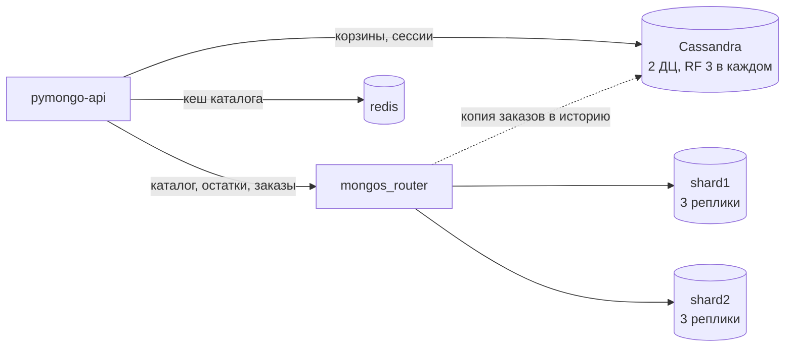

# Архитектурный документ: хранение данных «Мобильного мира»

Документ к заданиям 7–10: как шардировать коллекции `orders`, `products` и `carts` в MongoDB, что делать с «горячими» шардами, откуда читать данные и что из этого стоит перенести в Cassandra.

Исходная точка та же, что на стенде `sharding-repl-cache`: шардированный кластер MongoDB, каждый шард это группа репликации из трёх узлов, приложение ходит в базу через `mongos`.

## Задание 7. Схемы коллекций и шард-ключи

При выборе ключа я смотрел на три вещи. Ключ должен быть в самых частых запросах, иначе `mongos` опрашивает все шарды. У него должно быть много разных значений и ровное распределение запросов по ним, иначе получится перекошенный шард. И он не должен расти монотонно, иначе все вставки идут в один чанк.

Сводка по трём коллекциям:

| Коллекция | Шард-ключ | Стратегия | Запросы в один шард | Запросы по всем шардам |
|---|---|---|---|---|
| `orders` | `{customer_id: "hashed", created_at: 1}` | хешированная, составной ключ | создание заказа, история заказов клиента, статус заказа | отчёты по всем заказам |
| `products` | `{_id: "hashed"}` | хешированная | карточка товара, списание остатков | поиск по категории и цене |
| `carts` | `{owner_id: "hashed"}` | хешированная | все операции с корзиной | нет |

### orders

```js
{
  _id: ObjectId("..."),
  customer_id: "c-102938",          // string
  created_at: ISODate("2026-11-27T10:15:00Z"),
  items: [                          // цена фиксируется на момент заказа
    {product_id: ObjectId("..."), name: "Смартфон X", price: NumberDecimal("59990.00"), quantity: 1}
  ],
  status: "paid",                   // created | paid | shipped | delivered | cancelled
  total: NumberDecimal("59990.00"),
  geo_zone: "moscow"
}
```

Кандидаты в ключи: `_id`, `customer_id`, `created_at`, `geo_zone`, `status`.

- `created_at` и `_id` (ObjectId) растут монотонно. При диапазонном ключе все новые заказы попадут в последний чанк, и в распродажу один шард примет всю запись.
- `geo_zone` и `status` принимают несколько значений. Москва даст больше половины заказов, чанк с ней нельзя будет разделить.
- `customer_id` есть в двух из трёх основных операций, клиентов много, заказы между ними распределены ровно.

Выбрал составной ключ `{customer_id: "hashed", created_at: 1}`. Хеш от `customer_id` раскладывает клиентов по шардам равномерно, а все заказы одного клиента остаются на одном шарде. История заказов читается одним запросом в один шард и уже отсортирована по дате. Вторая часть ключа нужна на случай очень активных клиентов (оптовики, маркетплейсы): их заказы можно разделить на несколько чанков по дате, чанк не станет неделимым.

Статус заказа сайт запрашивает в личном кабинете, `customer_id` там известен, поэтому запрос `{customer_id, _id}` тоже уходит в один шард. Запрос только по `_id` (например, из письма со ссылкой) пойдёт по всем шардам. Это редкий сценарий, и на каждом шарде он отработает по индексу `_id`.

Создание заказа со списанием остатков затрагивает две коллекции, поэтому идёт в транзакции: вставка в `orders` и `$inc` в `products`. Транзакция получается распределённой, это цена шардирования. Чтобы она была короткой, списание делаю условным обновлением (пример ниже), без предварительного чтения.

Риск: если появится клиент с миллионами заказов, его шард будет нагружен сильнее других. Составной ключ позволяет хотя бы делить его данные на чанки, но не разносить по шардам.

### products

```js
{
  _id: ObjectId("..."),
  name: "Смартфон X",
  category: "electronics",
  price: NumberDecimal("59990.00"),
  stock: [                          // остаток по геозонам
    {geo_zone: "ekaterinburg", quantity: 50},
    {geo_zone: "kaliningrad", quantity: 30}
  ],
  attributes: {color: "black", size: "6.1"}
}
```

Кандидаты: `_id`, `category`, `{category, price}`, `{category, _id}`.

Ключ с категорией в начале хорошо подходит под поиск: запрос по категории уходит в один-два шарда. Но категорий мало, и нагрузка между ними неровная. Именно такой ключ приводит к ситуации из задания 8, когда «Электроника» грузит один шард. К тому же две самые частые операции, обновление остатков и карточка товара, идут по `_id`, а не по категории.

Выбрал `{_id: "hashed"}`. Списание остатков и чтение карточки попадают в один шард, товары любой категории размазаны по всем шардам, перекоса из-за популярной категории нет.

Плата за это: поиск по категории с фильтром по цене опрашивает все шарды. Я считаю это приемлемым. На каждом шарде запрос идёт по индексу `{category: 1, price: 1}`, шарды отвечают параллельно, а выдача каталога меняется редко и хорошо кешируется в Redis (как на стенде). Остатки в кеш каталога не кладу, их показывает карточка товара. Кеш выдачи живёт 60 секунд, как на стенде. Чтобы цена в выдаче не расходилась с карточкой и это время, при изменении цены или описания товара сервис сразу удаляет ключи выдачи его категории. Цена и остаток в любом случае перечитываются с primary при оформлении заказа.

Остатки лежат массивом внутри товара. Обновление одного товара атомарно, поэтому списание не уведёт остаток в минус:

```js
db.products.updateOne(
  {_id: productId, stock: {$elemMatch: {geo_zone: "ekaterinburg", quantity: {$gte: 1}}}},
  {$inc: {"stock.$.quantity": -1}}
)
```

Риск: если поиск по каталогу перестанет помещаться в кеш и станет основной нагрузкой, все шарды будут заняты им одновременно. Тогда каталог стоит вынести в поисковый движок, а MongoDB оставить для карточек и остатков.

### carts

```js
{
  _id: ObjectId("..."),
  owner_id: "u:c-102938",           // "u:<user_id>" или "s:<session_id>", заполняет приложение
  user_id: "c-102938",              // null у гостя
  session_id: null,                 // заполнен у гостя
  items: [{product_id: ObjectId("..."), quantity: 2}],
  status: "active",                 // active | ordered | abandoned
  created_at: ISODate("..."),
  updated_at: ISODate("..."),
  expires_at: ISODate("...")        // TTL
}
```

Кандидаты: `_id`, `user_id`, `session_id`, `status`.

Сложность в том, что корзину ищут по одному из двух полей: `session_id` у гостя и `user_id` у пользователя. Ни одно из них не заполнено во всех документах, значит ни одно не годится в ключ само по себе. `status` не подходит из-за трёх значений. С ключом `_id` каждое получение корзины опрашивало бы все шарды, а это самая частая операция.

Поэтому добавил поле `owner_id`, в которое приложение при создании корзины пишет владельца с префиксом типа, и шардирую по `{owner_id: "hashed"}`. Запросы из условия превращаются в `{owner_id: "s:<session_id>", status: "active"}` и `{owner_id: "u:<user_id>", status: "active"}`, оба идут в один шард. Добавление и удаление товара тоже адресуются по `owner_id`. Хеш нужен потому, что идентификаторы сессий и пользователей могут быть последовательными.

Слияние гостевой корзины при входе затрагивает два документа, которые могут лежать на разных шардах: читаю гостевую, добавляю её `items` в пользовательскую, помечаю гостевую `abandoned`. Делаю это в транзакции. Операция редкая (один раз на вход), распределённая транзакция здесь не страшна.

Старые корзины удаляет TTL-индекс по `expires_at`, приложение сдвигает это поле при каждом изменении корзины.

Риск: `owner_id` дублирует данные двух других полей, и за его заполнение отвечает приложение. Ошибка в коде создаст корзину, которую не найти обычным запросом. Закрываю это валидацией схемы (`owner_id` обязателен).

### Команды

```js
sh.enableSharding("shop")
use shop

sh.shardCollection("shop.orders", {customer_id: "hashed", created_at: 1})
sh.shardCollection("shop.products", {_id: "hashed"})
sh.shardCollection("shop.carts", {owner_id: "hashed"})

db.products.createIndex({category: 1, price: 1})
db.carts.createIndex({owner_id: 1, status: 1})
db.carts.createIndex({expires_at: 1}, {expireAfterSeconds: 0})

// история заказов клиента, один шард
db.orders.find({customer_id: "c-102938"}).sort({created_at: -1}).limit(20)

// текущая корзина гостя, один шард
db.carts.findOne({owner_id: "s:9f2c1e", status: "active"})

// проверить, как данные легли по шардам
db.orders.getShardDistribution()
```

## Задание 8. «Горячие» шарды

Ситуация из условия: товары лежат по шардам так, что «Электроника» оказалась на одном из них, и на него приходится 70% запросов. Так бывает, если `products` шардирована по диапазону с категорией в начале ключа. Дальше в примерах исходный ключ `{category: 1, _id: 1}`. Важная деталь: балансировщик MongoDB выравнивает шарды по объёму данных, а не по числу запросов. Шард может быть средним по размеру и при этом самым нагруженным, поэтому одного балансировщика мало и нужен мониторинг именно нагрузки.

### Метрики

| Метрика | Откуда брать | Когда тревога |
|---|---|---|
| Операции в секунду по каждому шарду (чтение, запись) | `db.serverStatus().opcounters` на primary шарда | доля одного шарда в полтора раза больше равной (при четырёх шардах это 37%) |
| Время ответа по шардам, p95 и p99 | `db.serverStatus().opLatencies`, профилировщик | p99 шарда вдвое выше, чем у остальных, или выше 100 мс на чтении карточки |
| CPU, диск, память узлов шарда | метрики хоста | CPU выше 70% дольше 10 минут |
| Очередь операций | `db.serverStatus().globalLock.currentQueue` | очередь не пустая дольше минуты |
| Объём данных и число документов по шардам | `db.products.getShardDistribution()` | отклонение от среднего больше 20% |
| Число чанков по шардам, неделимые (jumbo) чанки | `sh.status()`, коллекция `config.chunks` | появился jumbo-чанк |
| Состояние балансировщика и миграций | `sh.isBalancerRunning()`, `config.changelog` | миграции падают или идут в часы пик |
| Самые нагруженные коллекции и запросы | `mongotop`, `$currentOp`, `$indexStats` | одна коллекция занимает больше половины времени шарда |
| Доля запросов по всем шардам | `explain()`: в плане `SHARD_MERGE` вместо `SINGLE_SHARD` | растёт после релиза |
| Отставание реплик | `rs.printSecondaryReplicationInfo()` | больше 10 секунд |

Метрики собираю экспортером в Prometheus, на дашборде все шарды рядом на одном графике. Перекос так виден сразу, на отдельных графиках его легко пропустить.

Ориентиры на распродажу: p99 чтения карточки товара до 100 мс, p99 списания остатка до 200 мс, ни один шард не берёт больше полутора равных долей запросов. Проверяю это нагрузочным тестом до распродажи: профиль, в котором 70% запросов идут в «Электронику», на ожидаемом пиковом RPS. Тест пройден, если ни один порог из таблицы не сработал.

### Что делать при перекосе

Сначала разбираюсь, чего на шарде много: данных или запросов.

```js
db.products.getShardDistribution()   // объём и документы по шардам
sh.status()                          // чанки и их диапазоны
db.getSiblingDB("config").chunks.aggregate([{$group: {_id: "$shard", chunks: {$sum: 1}}}])
```

Дальше по ситуации:

1. Много данных на одном шарде. Проверяю, что балансировщик включён, и даю ему работать вне пика:

   ```js
   sh.getBalancerState()
   sh.startBalancer()
   db.getSiblingDB("config").settings.updateOne(
     {_id: "balancer"},
     {$set: {activeWindow: {start: "02:00", stop: "06:00"}}},
     {upsert: true}
   )
   ```
2. Данных поровну, но запросы бьют в один диапазон. Делю горячий чанк и переношу часть на менее загруженный шард вручную:

   ```js
   // в запросе нужен полный шард-ключ: беру любой товар из горячего диапазона
   sh.splitFind("shop.products", {category: "electronics", _id: ObjectId("6af710eeb5e4d20148610818")})
   sh.moveChunk("shop.products", {category: "electronics", _id: ObjectId("6af710eeb5e4d20148610818")}, "shard2")
   ```
3. Горячая категория целиком. Выделяю под неё отдельные шарды через зоны, балансировщик сам перенесёт туда чанки:

   ```js
   sh.addShardToZone("shard3", "electronics")
   sh.addShardToZone("shard4", "electronics")
   sh.updateZoneKeyRange("shop.products",
     {category: "electronics", _id: MinKey}, {category: "electronics", _id: MaxKey}, "electronics")
   ```

   Зоны задаются диапазонами шард-ключа, поэтому работают только пока ключ начинается с `category`.
4. Перекос заложен в самом ключе. Меняю ключ на хешированный из задания 7. С MongoDB 5.0 это делается без остановки:

   ```js
   db.adminCommand({reshardCollection: "shop.products", key: {_id: "hashed"}})
   ```

   Решардинг копирует всю коллекцию, поэтому запускаю его заранее, а не во время распродажи. Если на коллекции были зоны из пункта 3, их диапазоны под новый ключ не подходят: зоны сначала убираю или передаю в команду `zones: []`.
5. Ёмкости не хватает всем. Добавляю шард, балансировщик переносит на него часть чанков:

   ```js
   sh.addShard("shard3/shard3-1:27021,shard3-2:27021,shard3-3:27021")
   ```

Автоматически из этого работают балансировщик (сам делит и переносит чанки по объёму) и зоны (сам держит диапазоны на назначенных шардах). Пункты 2 и 4 запускает дежурный по алерту, я бы не автоматизировал их до тех пор, пока не накопится статистика срабатываний.

Чтобы снять нагрузку быстрее, чем переедут данные, использую то, что уже есть на стенде: кеш выдачи популярных категорий в Redis и чтение каталога с secondary (задание 9). Перед распродажей смотрю прошлогоднюю статистику по категориям и готовлю зоны и дополнительные шарды заранее.

## Задание 9. Чтение с реплик и консистентность

Репликация в MongoDB асинхронная: запись принимает primary, на secondary она доезжает с задержкой. Даже при `w: "majority"` один из трёх узлов может отставать. Чтение с secondary разгружает primary, но может вернуть устаревшие данные. Поэтому правило простое: если по прочитанному значению принимается решение о записи или пользователь ждёт увидеть своё же только что сделанное изменение, читаю с primary. Остальное можно отдать репликам.

| Коллекция | Операция чтения | Откуда | Допустимое отставание | Почему |
|---|---|---|---|---|
| `products` | Остаток при оформлении заказа | primary | 0 | По остатку списывается товар. Устаревшее значение означает продажу того, чего нет |
| `products` | Карточка товара: описание, цена, атрибуты | secondary | до 10 с | Меняется редко. Цена и остаток перепроверяются на primary при оформлении |
| `products` | Наличие в карточке («в наличии», «осталось мало») | secondary | до 10 с | Это подсказка, а не резерв. Ошибка всплывёт на шаге оформления, а не после оплаты |
| `products` | Поиск по категории и цене | secondary | до 60 с | Самая массовая нагрузка на чтение, данные почти статичны, выдача ещё и кешируется |
| `orders` | Заказ сразу после создания или оплаты | primary | 0 | Пользователь только что его оформил. Если страница скажет «заказ не найден», он оформит второй |
| `orders` | Статус заказа в личном кабинете | primary | 0 | Статус меняется часто (оплата, сборка, доставка), по нему человек решает, ехать ли за заказом |
| `orders` | История заказов | secondary | до 30 с | Старые заказы не меняются, новый заказ в списке может появиться с задержкой в секунды |
| `orders` | Отчёты и аналитика | secondary | минуты | Запросы тяжёлые, не должны мешать продажам. Для них можно выделить реплику с `priority: 0` и тегом и читать с неё через `readPreference` с этим тегом |
| `carts` | Текущая корзина | primary | 0 | Меняется при каждом клике. Старая версия выглядит так, будто товар не добавился |
| `carts` | Чтение при слиянии и перед оформлением | primary | 0 | Чтение перед записью: по содержимому создаётся заказ |
| `carts` | Счётчик товаров в шапке сайта | primary | 0 | Берётся из того же запроса, что и корзина |
| `carts` | Брошенные корзины для рассылок | secondary | минуты | Фоновая задача, точность до минуты не нужна |

По частоте обновлений получается так. `carts` меняется постоянно и читается сразу после записи, поэтому почти вся работа с ней идёт через primary. `orders` пишется реже, но свежесть статуса важна, на реплики уходят только история и отчёты. `products` читается намного чаще, чем меняется (кроме остатков), поэтому здесь реплики дают основной выигрыш.

### Как это настраивается

По умолчанию подключение читает с primary. На реплики увожу отдельные запросы, чтобы случайно не отправить туда критичные чтения. Сервис каталога, которому primary не нужен совсем, может задать режим сразу в строке подключения:

```
mongodb://mongos_router:27020/shop?readPreference=secondaryPreferred&maxStalenessSeconds=90
```

```js
// поиск по каталогу: с реплики
db.products.find({category: "electronics", price: {$gte: 10000, $lte: 50000}})
  .readPref("secondaryPreferred")

// остаток перед списанием: только primary и только подтверждённые большинством данные
db.products.find({_id: productId}).readPref("primary").readConcern("majority")

// записи заказов подтверждаются большинством узлов
db.orders.insertOne(order, {writeConcern: {w: "majority", wtimeout: 5000}})
```

`maxStalenessSeconds` в MongoDB не может быть меньше 90 секунд, поэтому пороги 10–60 секунд из таблицы драйвер сам не обеспечит. Их держу мониторингом отставания: если реплика отстала больше порога, алерт, и чтение каталога временно переводится на primary.

```js
rs.printSecondaryReplicationInfo()   // отставание каждой реплики
rs.status().members.map(m => ({name: m.name, state: m.stateStr, optime: m.optimeDate}))
```

Действия при проблемах:

| Что видим | Что делаем |
|---|---|
| Отставание реплики больше 10 с | Убираем с неё чтение карточек (`maxStalenessSeconds` плюс тег реплики), ищем причину: диск, сеть, тяжёлый запрос |
| Отставание больше 60 с | Весь каталог читаем с primary, пока реплика не догонит |
| Пользователи не видят свои заказы | Проверяем, что чтение заказа после записи идёт с primary или в causal-consistent сессии |
| Primary перегружен чтением | Проверяем, какие запросы можно увести на secondary по таблице выше, добавляем реплику |

Для сценария «записал и сразу прочитал» есть ещё вариант: сессия с причинной согласованностью (`causalConsistency: true`), тогда чтение с реплики дождётся нужной записи. Я оставил чтение с primary, это проще и предсказуемее.

### Что происходит при отказах

Чтение с реплик имеет смысл, только если путь пользователя «каталог, корзина, заказ» переживает отказ узла целиком. Ориентиры: доступность пути 99,95%, при отказе одного узла восстановление до 15 секунд без участия человека, подтверждённые заказы не теряются (`w: "majority"`). Проверяю так же, как на стенде: останавливаю узел под нагрузкой и смотрю долю ошибок и время до первого успешного ответа.

| Что отказало | Что видит пользователь | Как переключается |
|---|---|---|
| Secondary шарда | Ничего. Чтения каталога идут на вторую реплику или на primary | Сам драйвер, `secondaryPreferred` |
| Primary шарда | Запись и чтения с primary по данным этого шарда ждут выборов. Второй шард работает | Автоматически, выборы занимают до 12 секунд. На стенде остановил primary `shard1`: им стал `shard1-2`, запросы приложения не падали |
| Два узла шарда из трёх | Каталог с оставшейся реплики читается, корзины и заказы этого шарда не пишутся | Автоматически не лечится, нужно вернуть узел. Поэтому узлы шарда стоят в разных зонах доступности |
| `mongos_router` | Приложение теряет базу целиком | На стенде роутер один, это единая точка отказа. В бою роутеров минимум два, оба в строке подключения, драйвер переключается сам |
| `configSrv` | Запросы по уже известным маршрутам идут, но нет миграций чанков, а перезапущенный `mongos` не поднимется | На стенде один узел. В бою группа репликации из трёх, выборы как у шарда |
| `redis` | На стенде `/helloDoc/users` отвечает 500, остальные эндпоинты работают (проверил остановкой контейнера) | Кеш не должен быть обязательным звеном. В бою Redis с репликой и автоматическим переключением, а ошибку кеша приложение считает промахом и идёт в MongoDB. Образ приложения по условию менять нельзя, на стенде ограничение остаётся |
| Инстанс `pymongo-api` | Ничего | Consul убирает его из списка живых по health check, API Gateway перестаёт слать туда трафик |

## Задание 10. Миграция на Cassandra

Проблема из условия: при диапазонном шардировании добавление шарда в пик запускало массовый перенос чанков, и latency проседала. В Cassandra данные раскладываются по кольцу согласованным хешированием с виртуальными узлами. Новый узел забирает небольшие диапазоны у многих соседей, остальные данные не двигаются. Лидера нет, запись принимает любой узел.

### 10.1. Какие данные переносить

Cassandra выигрывает там, где много записи, запросы идут по заранее известному ключу и допустима согласованность в конечном счёте. Она проигрывает там, где нужны транзакции, произвольные фильтры и строгая консистентность.

| Данные | Критичны по | Куда | Обоснование |
|---|---|---|---|
| Корзины | скорости и доступности | Cassandra | Самая частая запись на сайте, всегда по владельцу. Потеря секунды свежести не страшна, недоступность корзины в распродажу означает потерянные продажи. Есть встроенный TTL |
| Пользовательские сессии | скорости и доступности | Cassandra | Простое чтение и запись по ключу, TTL, огромный поток в пик |
| История заказов | доступности и масштабу | Cassandra, копия | Только дописывается, читается по клиенту, растёт бесконечно. Хорошо ложится на «партиция на клиента». Это копия для чтения, решения по ней не принимаются |
| Оформление заказа и его текущий статус | целостности | остаётся в MongoDB | Заказ создаётся вместе со списанием остатков, это одна транзакция. В Cassandra транзакций на несколько таблиц нет, а без неё сервис может не увидеть актуальный остаток и продать то, что уже закончилось |
| Остатки товаров | целостности | остаются в MongoDB | Нужно атомарное «проверить и уменьшить» в одной транзакции с заказом. В Cassandra это лёгкие транзакции (Paxos) в пределах одной партиции, они в разы медленнее обычной записи и плохо держат конкуренцию за один товар |
| Каталог товаров | скорости чтения | остаётся в MongoDB | Поиск по категории, цене и атрибутам. В Cassandra под каждый фильтр нужна отдельная таблица |

То есть в Cassandra уходят корзины, сессии и история заказов. Товары с остатками и сами заказы остаются в MongoDB с ключами из задания 7. По геораспределённости: кластер Cassandra ставлю в несколько дата-центров, каждый клиент пишет в ближайший.



Оформление заказа не меняется относительно задания 7: вставка в `orders` и условное списание остатка в `products` идут одной транзакцией MongoDB, с чтением с primary и записью с `w: "majority"`. Заказ либо создан вместе со списанием, либо не создан совсем, и остаток всегда проверяется по актуальным данным. Разносить заказ и остатки по разным базам я не стал: общей транзакции у них бы не было, и после сбоя между двумя шагами остаток был бы списан без заказа или заказ создан без списания.

В Cassandra заказ попадает уже после фиксации транзакции. Отдельный обработчик читает изменения коллекции `orders` (change stream) и дописывает их в таблицу истории. Запись идемпотентная, по тому же ключу, поэтому повтор после сбоя ничего не ломает. История может отставать на секунды, это допустимо: текущий статус заказа и всё, от чего зависят деньги и остатки, читается из MongoDB.

Нагрузку с MongoDB это всё равно снимает. Корзины и сессии дают основной поток записи в распродажу. Завершённые заказы старше года после копирования в историю из MongoDB удаляются, поэтому `orders` там не растёт бесконечно, и перенос чанков при добавлении шарда короче.

### 10.2. Модель данных

В Cassandra таблица проектируется под запрос. Partition key определяет узел, на котором лежит партиция, clustering key задаёт порядок строк внутри неё.

```sql
CREATE KEYSPACE shop WITH replication = {
  'class': 'NetworkTopologyStrategy', 'dc_moscow': 3, 'dc_ekb': 3
};

-- корзина: одна партиция на владельца, строка на товар
CREATE TABLE shop.carts (
  owner_id   text,        -- "u:<user_id>" или "s:<session_id>"
  product_id text,        -- _id товара из MongoDB
  quantity   int,
  updated_at timestamp,
  PRIMARY KEY ((owner_id), product_id)
) WITH default_time_to_live = 2592000;   -- 30 дней

-- сессии
CREATE TABLE shop.sessions (
  session_id uuid PRIMARY KEY,
  user_id    text,
  data       map<text, text>,
  created_at timestamp
) WITH default_time_to_live = 86400;

CREATE TYPE shop.order_item (product_id text, name text, price decimal, quantity int);

-- история заказов клиента, новые сверху. Копия из MongoDB
CREATE TABLE shop.orders_by_customer (
  customer_id text,
  year        int,
  created_at  timestamp,
  order_id    text,        -- _id заказа из MongoDB
  status      text,
  total       decimal,
  items       list<frozen<order_item>>,
  PRIMARY KEY ((customer_id, year), created_at, order_id)
) WITH CLUSTERING ORDER BY (created_at DESC, order_id ASC);
```

| Таблица | Partition key | Clustering key | Запрос |
|---|---|---|---|
| `carts` | `owner_id` | `product_id` | корзина владельца, добавить, заменить, удалить товар |
| `sessions` | `session_id` | нет | сессия по идентификатору |
| `orders_by_customer` | `(customer_id, year)` | `created_at DESC, order_id` | история заказов клиента |

Почему ключи такие:

- Все partition key имеют высокую кардинальность (владелец, сессия, клиент). Хеш от них раскладывает партиции по кольцу равномерно, и запросы распределяются так же.
- В ключах партиций нет категории, геозоны, статуса и даты. Партиция «Электроника» или «заказы за 27 ноября» была бы огромной и горячей, это та же проблема, что в задании 8.
- В `orders_by_customer` в ключ партиции добавлен год. Партиция одного клиента не растёт бесконечно, а история за год читается одним запросом в одну партицию.
- В `carts` товар это отдельная строка. Добавление и удаление товара меняют одну строку, а не перезаписывают всю корзину, поэтому параллельные изменения с двух устройств не затирают друг друга. Пометка «заказана» не нужна: после оформления партиция удаляется, брошенные корзины убирает TTL. TTL в Cassandra считается для каждой строки отдельно, поэтому при изменении корзины приложение обновляет `updated_at` у всех её строк, и срок жизни сдвигается у корзины целиком.
- Слияние гостевой корзины: читаю партицию `s:<session_id>`, записываю строки в `u:<user_id>` одним batch, удаляю гостевую.
- В истории заказ лежит целиком, вместе с составом. Это денормализация вместо соединений: страница «мои заказы» читается одним запросом в одну партицию и не ходит в MongoDB.

Решардинг при изменении топологии: с виртуальными узлами новый узел получает много мелких диапазонов кольца и забирает данные понемногу у всех, а не половину у одного. Ключи остальных партиций не пересчитываются. Перенос идёт потоково в фоне, кластер продолжает обслуживать запросы. Перед распродажей узлы всё равно добавляю заранее, чтобы перенос не совпал с пиком.

Ориентир из условия 50 000 запросов в секунду. Проверяю нагрузочным тестом (`cassandra-stress`) на этом потоке с добавлением узла прямо во время теста: p99 записи в корзину должен оставаться до 20 мс, p99 чтения до 50 мс, пока идёт перенос диапазонов.

### 10.3. Восстановление целостности

Все три механизма работают в кластере одновременно. Выбор состоит в том, на какой из них я полагаюсь для конкретных данных и с каким уровнем согласованности (Consistency Level) пишу и читаю. Фактор репликации везде 3.

| Сущность | CL записи / чтения | Основной механизм | Почему |
|---|---|---|---|
| `orders_by_customer` | `LOCAL_QUORUM` / `LOCAL_QUORUM` за текущий год, `ONE` за прошлые | Read Repair для свежих заказов, Anti-Entropy Repair раз в неделю для архива | Свежие заказы клиент открывает часто. W + R > N внутри дата-центра, чтение видит последнюю запись, а расхождение реплик исправляется при чтении, до ответа клиенту. Старые заказы читают редко, Read Repair до них не дойдёт, поэтому архив сходится полной сверкой по расписанию ночью. Плачу latency только там, где клиент смотрит на свежий статус |
| `carts` | `ONE` / `ONE` | Hinted Handoff, плюс Anti-Entropy Repair раз в неделю | Важнее скорость и доступность записи. Если реплика пропала на минуты, координатор сохранит подсказки и доиграет их. Изредка устаревшая корзина допустима. Repair нужен из-за удалений: если реплика пропустила удаление товара и не получила его до истечения `gc_grace_seconds` (10 дней), товар вернётся в корзину |
| `sessions` | `ONE` / `ONE` | Hinted Handoff | Сессии только пишутся и истекают по TTL через сутки, удалений нет. Полный repair для них дороже самих данных |

Компромисс между latency и гарантиями:

- Hinted Handoff ничего не стоит при чтении и записи, но лечит только короткие сбои. Подсказки хранятся ограниченное время (по умолчанию 3 часа), после долгого простоя узла он не поможет.
- Read Repair при кворумном чтении добавляет задержку к запросу: координатор сравнивает ответы реплик и чинит отставшие до ответа клиенту. Работает только для данных, которые читают.
- Anti-Entropy Repair (`nodetool repair`) даёт самую сильную гарантию, но нагружает CPU, диск и сеть. Запускаю по расписанию в ночное окно и обязательно после возвращения узла, который отсутствовал дольше срока хранения подсказок.

```shell
nodetool repair -pr shop orders_by_customer                    # сверка по расписанию
nodetool status                                               # состояние узлов кольца
nodetool listpendinghints                                     # накопленные hints по узлам
```

```sql
-- копия заказа в историю, после фиксации транзакции в MongoDB
CONSISTENCY LOCAL_QUORUM;
INSERT INTO shop.orders_by_customer (customer_id, year, created_at, order_id, status, total, items)
VALUES ('c-102938', 2026, '2026-11-27 10:15:00+0000', '6af7a1c2b5e4d2014861a001', 'created', 59990.00,
        [{product_id: '6af710eeb5e4d20148610818', name: 'Смартфон X', price: 59990.00, quantity: 1}]);

CONSISTENCY ONE;
UPDATE shop.carts SET quantity = 2, updated_at = toTimestamp(now())
WHERE owner_id = 's:9f2c1e' AND product_id = '6af710eeb5e4d20148610818';
```

Что мониторить в Cassandra и что делать:

| Метрика | Тревога | Действие |
|---|---|---|
| Латентность чтения и записи на координаторе, p99 | выше 50 мс на чтении или 20 мс на записи | ищем перегруженный узел или большую партицию |
| Размер партиций (`nodetool tablehistograms`) | партиция больше 100 МБ | пересматриваем ключ партиции, добавляем в него период |
| Накопленные и просроченные hints | hints копятся дольше часа | проверяем недоступный узел, после возврата запускаем repair |
| Число несогласованных чтений (read repair) | заметный рост | внеплановый `nodetool repair` по таблице |
| Таймауты и `Unavailable` на `LOCAL_QUORUM` | любые | проверяем, сколько реплик живо. Если меньше двух из трёх, история заказов временно отстаёт, обработчик дозапишет её после восстановления. Оформление заказов от этого не зависит, корзины продолжают работать на `ONE` |
| Отставание истории от `orders` в MongoDB | больше минуты | проверяем обработчик change stream и доступность Cassandra |
| Загрузка узлов и pending compactions | перекос между узлами | проверяем распределение токенов, добавляем узлы |
